# Lab9Web — PHP Modular

## Praktikum 9: Modularisasi Program, Function, Template, dan Routing

| | |
|---|---|
| Nama | Febryvia Deya Nur Havidtar Murti Aqsa|
| NIM | 312510194 |
| Kelas | I251B |
| Program Studi | Teknik Informatika |
| Perguruan Tinggi | Universitas Pelita Bangsa |
| Mata Kuliah | Pemrograman Web |

## 1. Pendahuluan

Praktikum 9 membahas PHP Modular, yaitu teknik membagi program menjadi beberapa bagian berdasarkan fungsi dan tanggung jawabnya. Pada praktikum ini, aplikasi PHP dikembangkan dengan memisahkan file tampilan, function, konfigurasi, modul, dan routing agar kode lebih terstruktur dan mudah dikelola.

Praktikum dilakukan mulai dari memahami pemanggilan file PHP, membuat template halaman, menggunakan function, menyusun struktur direktori, menerapkan routing, menggunakan URL Rewrite, hingga mengintegrasikan aplikasi CRUD dari praktikum sebelumnya.

Pada tahap pengembangan, aplikasi juga dilengkapi dengan fitur login dan logout sebagai tambahan untuk membatasi akses terhadap halaman pengelolaan data pengguna.

## 2. Tujuan Praktikum

Tujuan dari Praktikum 9 adalah:

1. Memahami konsep dan manfaat modularisasi program.
2. Membedakan penggunaan `include`, `require`, `include_once`, dan `require_once`.
3. Membuat template halaman web yang dapat digunakan bersama.
4. Membuat dan menggunakan function PHP.
5. Menyusun struktur direktori aplikasi secara modular.
6. Menerapkan routing berdasarkan parameter URL.
7. Mengintegrasikan modularisasi dengan aplikasi database dari praktikum sebelumnya.
8. Mengembangkan aplikasi agar lebih terstruktur dan mudah dikelola.

## 3. Perangkat dan Teknologi

Perangkat dan teknologi yang digunakan dalam praktikum:

- Laptop atau komputer
- XAMPP (Apache dan MySQL/MariaDB)
- PHP 8.0 atau lebih baru (ekstensi `pdo_mysql` dan `mbstring`)
- MySQL/MariaDB
- HTML
- CSS
- JavaScript
- Visual Studio Code
- Web Browser
- Git dan GitHub

## 4. Cara Menjalankan Aplikasi

1. Salin folder `Lab9Web` ke dalam folder `htdocs` XAMPP (`C:\xampp\htdocs\Lab9Web`).
2. Jalankan **Apache** dan **MySQL** melalui XAMPP Control Panel.
3. Buka phpMyAdmin (`http://localhost/phpmyadmin`), lalu import file `Project/database/db_latihan.sql` melalui tab *Import*.
4. Sesuaikan user dan password MySQL pada `Project/config/database.php` apabila berbeda dari bawaan XAMPP (`root` tanpa password).
5. Isi data pada `Project/config/identitas.php`.
6. Buka aplikasi pada browser:

```text
http://localhost/Lab9Web/Project/index.php
```

7. Untuk mengakses halaman **Pengguna**, login terlebih dahulu. Akun uji mengikuti isi `Project/config/auth.php` (contoh: username `admin`, password `admin123`; ubah apabila akun diganti).
8. URL ringkas (opsional) membutuhkan `mod_rewrite` aktif dan `AllowOverride All`, serta konstanta `PRETTY_URL` pada `index.php` bernilai `true`.

## 5. Pelaksanaan Praktikum

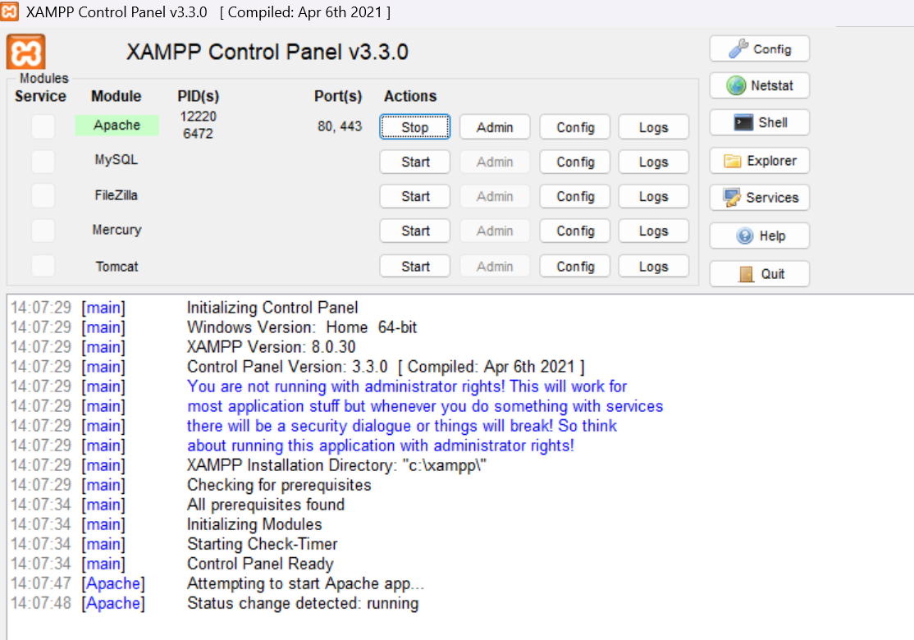

### 5.1 Praktik Pemanggilan File PHP

Pada tahap awal praktikum, dilakukan pengujian pemanggilan file PHP menggunakan `include` dan `require`.

Pemanggilan file digunakan agar kode dari file lain dapat dijalankan tanpa harus menuliskan ulang kode yang sama. Pengujian dilakukan dengan membuat file pesan.php dan file uji-include.php, kemudian memanggil file pesan.php dari file pengujian.

Percobaan juga dilakukan dengan mengubah nama file yang dipanggil untuk mengetahui perbedaan ketika file tidak ditemukan.

`include` memberikan peringatan ketika file tidak ditemukan, tetapi eksekusi program umumnya masih berlanjut. Sedangkan `require` menyebabkan error dan menghentikan eksekusi ketika file yang dibutuhkan tidak tersedia.

Selain itu, dipelajari juga `include_once` dan `require_once` yang digunakan untuk mencegah file dimuat berulang kali.

| Konstruksi | Jika file tidak ditemukan | Penggunaan umum |
|---|---|---|
| `include` | Warning, eksekusi berlanjut | File tambahan yang tidak kritis |
| `require` | Error fatal, eksekusi berhenti | File wajib, misalnya konfigurasi database |
| `include_once` | Seperti `include`, tanpa muat berulang | Helper opsional yang dipanggil dari beberapa modul |
| `require_once` | Seperti `require`, tanpa muat berulang | Konfigurasi atau file inti yang dimuat satu kali |

**Screenshot Praktik 1 — Pengujian Include dan Require**

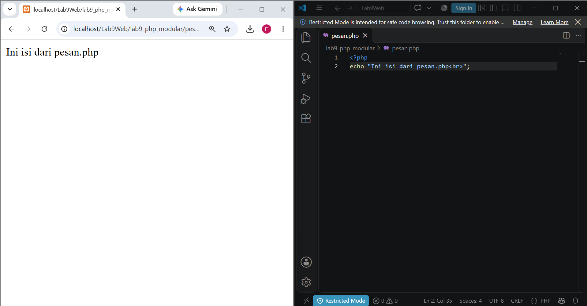


### 5.2 Membuat Template Layout

Pada tahap ini dibuat template halaman yang terdiri dari header, navigasi, konten utama, dan footer.

Template digunakan agar beberapa halaman dapat memiliki tampilan yang sama tanpa harus menulis ulang bagian header dan footer pada setiap file. File header.php digunakan untuk bagian awal halaman dan navigasi, sedangkan footer.php digunakan untuk bagian penutup halaman.

Kemudian dibuat halaman Home dan About untuk menguji penggunaan template. Kedua halaman menggunakan header dan footer yang sama, tetapi memiliki konten yang berbeda.

**Analisis hasil**

- **Bagian yang digunakan bersama oleh semua halaman:** header (awal dokumen HTML, judul, dan navigasi), footer (penutup halaman), serta berkas CSS.
- **Jika teks navigasi diubah pada header.php:** perubahan langsung terlihat pada semua halaman yang memuat header.php, tanpa mengubah file halaman satu per satu.
- **Alasan konten halaman tidak diletakkan seluruhnya di header.php:** header dipakai oleh semua halaman, sedangkan konten setiap halaman berbeda. Jika konten diletakkan di header.php, semua halaman akan menampilkan konten yang sama.
- **Manfaat `require_once` dibanding menyalin kode header ke setiap halaman:** kode tidak diduplikasi sehingga pemeliharaan lebih mudah, template tidak termuat ganda, dan aplikasi berhenti dengan error yang jelas apabila file template hilang.

**Screenshot Praktik 2 — Template Header dan Navigasi**

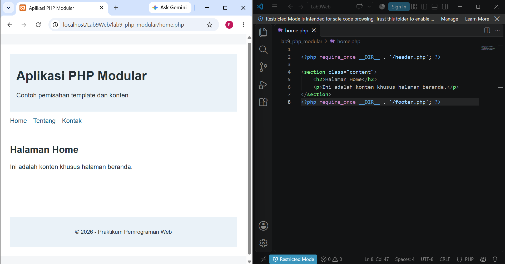

**Screenshot Praktik 3 — Template Footer dan Halaman**

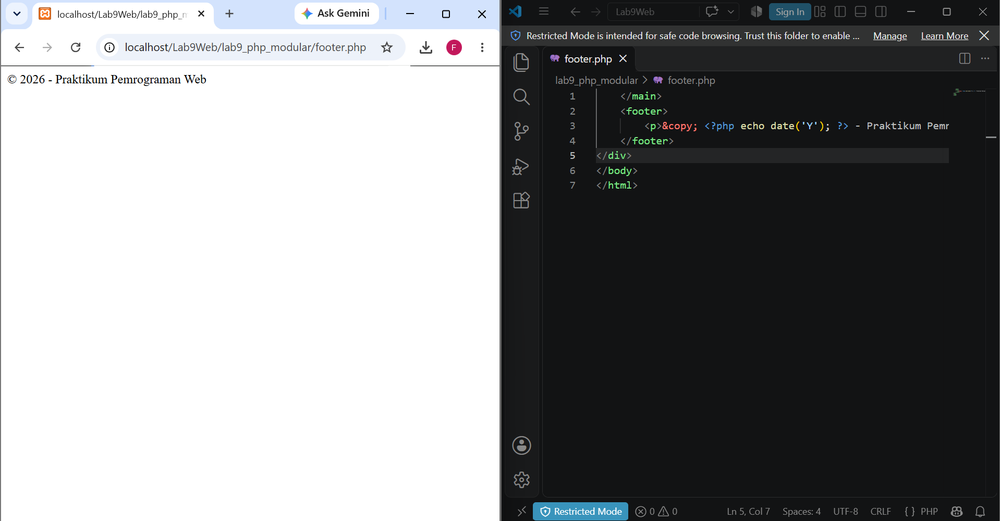

**Mencoba percobaan**

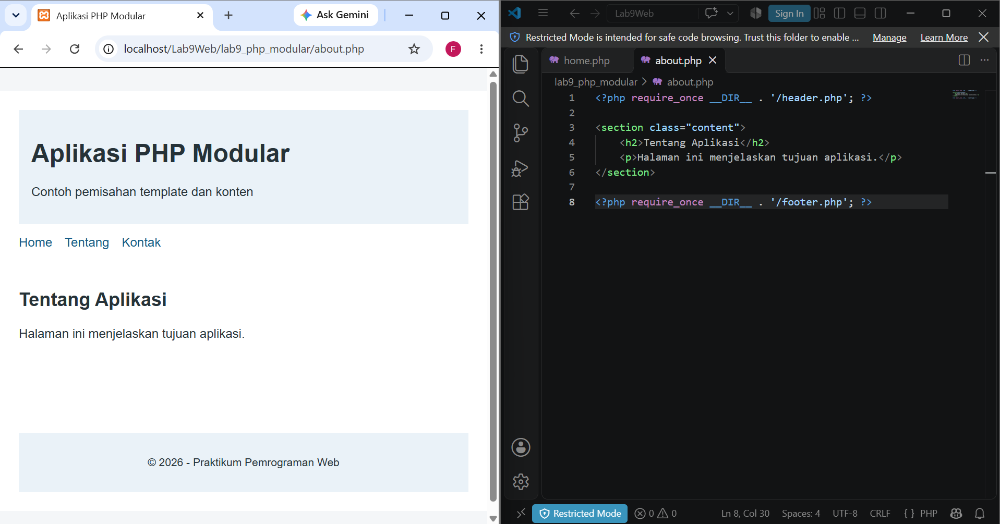


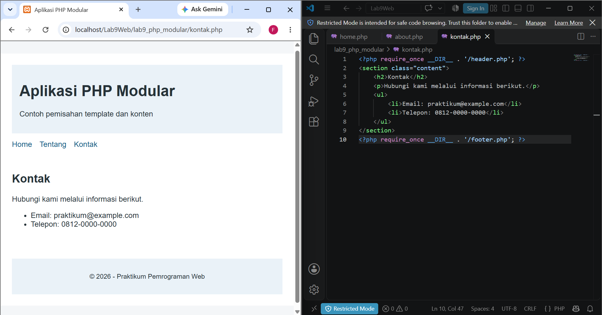

### 5.3 Membuat Function PHP

Praktikum dilanjutkan dengan mempelajari function PHP. Function merupakan blok kode yang memiliki nama dan dapat dipanggil kembali ketika dibutuhkan.

Function yang dipelajari meliputi function tanpa parameter, function dengan parameter, function dengan return, serta function dengan type declaration dan nilai default.

Function juga dipisahkan ke dalam file helper agar dapat digunakan kembali pada halaman yang berbeda.

Beberapa function yang dikembangkan pada project antara lain:

- `formatRupiah()` untuk mengubah angka menjadi format mata uang Rupiah.
- `hitungDiskon()` untuk menghitung nilai diskon.
- `validasiEmail()` untuk melakukan validasi email.
- `ringkasTeks()` untuk membatasi atau meringkas teks.
- `e()` untuk melakukan escaping pada teks sebelum ditampilkan ke HTML.
- `baseUrl()` dan `url()` untuk membantu pengelolaan URL.
- `redirect()` untuk mengarahkan pengguna ke halaman lain.
- `isActive()` untuk menentukan menu yang sedang aktif.

Function tersebut dikumpulkan dalam file `helpers/functions.php` agar dapat digunakan kembali oleh berbagai bagian aplikasi.

Perbedaan istilah pada function:

- **Parameter** adalah variabel yang didefinisikan pada deklarasi function.
- **Argumen** adalah nilai yang dikirim ketika function dipanggil.
- **Nilai return** adalah nilai yang dikembalikan function kepada pemanggilnya, berbeda dengan `echo` yang hanya menampilkan keluaran.

**Screenshot Function dan contoh**

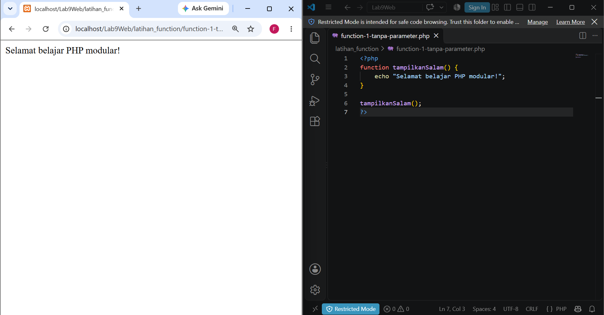

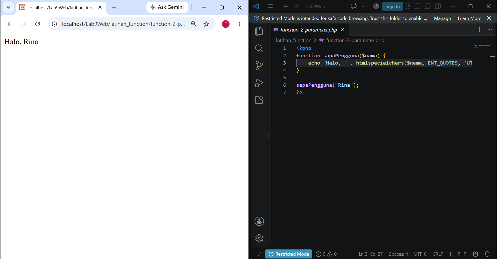

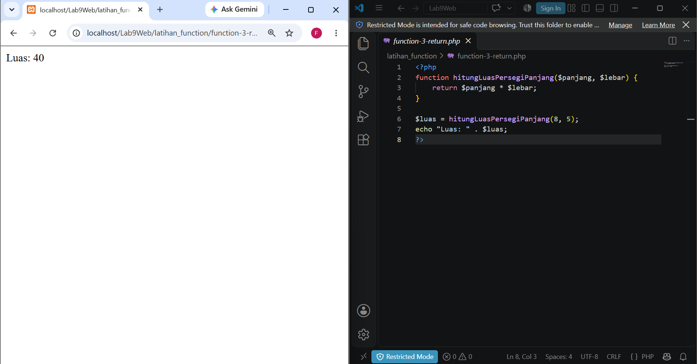

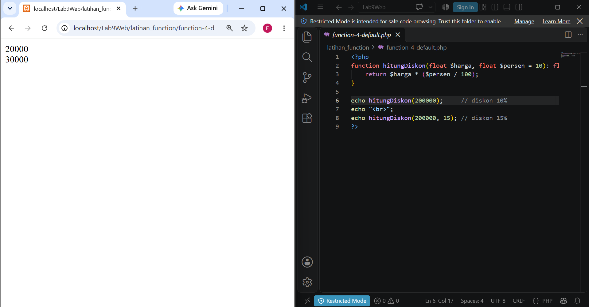

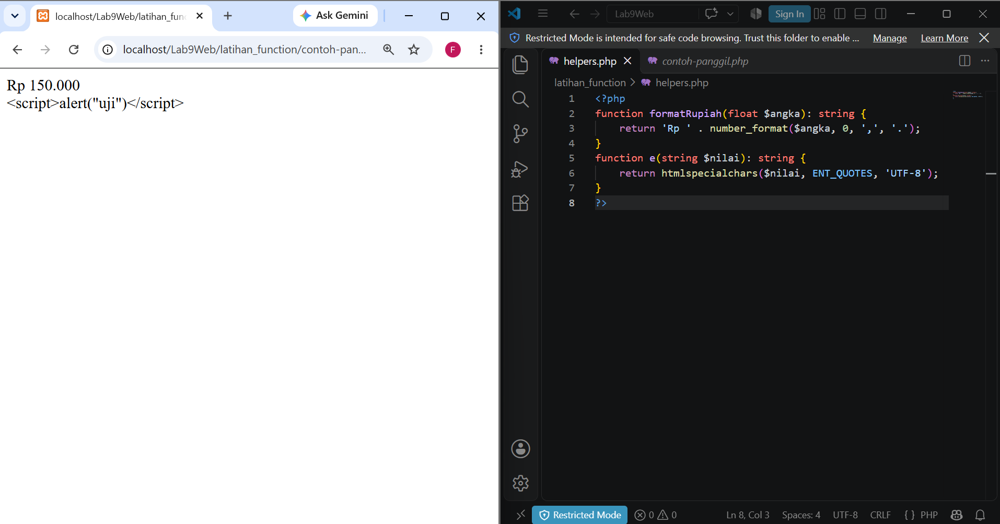

**Screenshot Latihan 1 — Function PHP**


**Screenshot Latihan 2 — Helper Functions**


### 5.4 Menyusun Struktur Direktori Modular

Setelah memahami template dan function, aplikasi mulai disusun menggunakan struktur direktori modular.

Setiap file ditempatkan sesuai tanggung jawabnya, seperti konfigurasi, tampilan, helper, modul, dan aset. Pemisahan ini dilakukan agar file aplikasi tidak bercampur dalam satu direktori dan lebih mudah ditemukan ketika diperlukan perubahan.

Struktur direktori yang digunakan dalam project:

```text
Project/
├── index.php
├── .htaccess
├── config/
│   ├── database.php
│   ├── identitas.php
│   └── auth.php
├── views/
│   ├── header.php
│   ├── footer.php
│   ├── dashboard.php
│   ├── 404.php
│   └── user_form.php
├── helpers/
│   └── functions.php
├── modules/
│   ├── page/
│   │   ├── profil.php
│   │   ├── kontak.php
│   │   └── helper.php
│   ├── user/
│   │   ├── list.php
│   │   ├── add.php
│   │   ├── edit.php
│   │   └── delete.php
│   └── auth/
│       ├── login.php
│       └── logout.php
├── assets/
│   ├── css/
│   │   └── style.css
│   └── js/
│       └── app.js
└── database/
    └── db_latihan.sql
```

Struktur tersebut digunakan untuk memisahkan file berdasarkan kegunaannya, sehingga pengembangan aplikasi dapat dilakukan dengan lebih terorganisasi.

| Bagian | Tanggung jawab |
|---|---|
| `index.php` | Titik masuk aplikasi dan pengatur pemanggilan halaman (router) |
| `config/` | Konfigurasi aplikasi, termasuk koneksi database dan akun login |
| `views/` | Komponen tampilan bersama: header, footer, dashboard, halaman 404, dan partial form |
| `helpers/` | Function umum yang dapat digunakan oleh banyak modul |
| `modules/` | Fitur aplikasi yang dikelompokkan berdasarkan fungsi (`page`, `user`, `auth`) |
| `assets/` | File statis seperti CSS dan JavaScript |
| `database/` | Skrip SQL pembuatan database dan tabel |

**Screenshot Praktik 6 — Struktur Direktori Project**

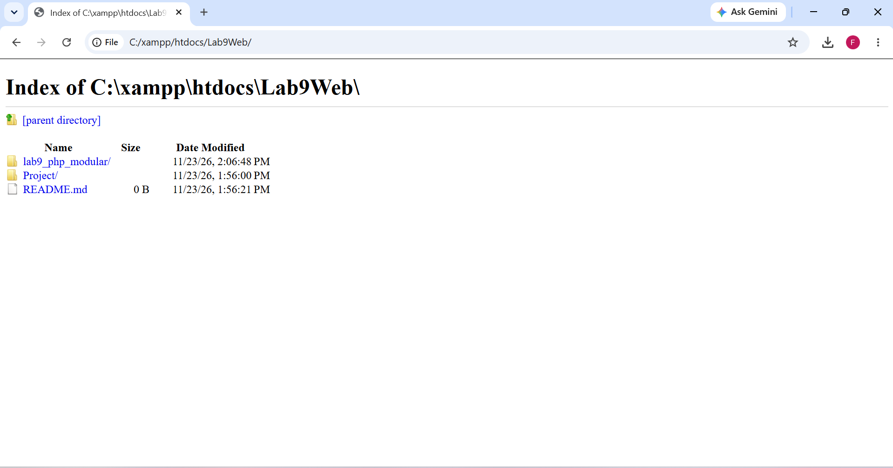

### 5.5 Membuat Routing

Routing diterapkan menggunakan file index.php sebagai titik masuk utama aplikasi.

Pada tahap ini, parameter page digunakan untuk menentukan halaman yang akan ditampilkan. Setiap rute didaftarkan dalam array routes yang berisi daftar halaman dan lokasi file yang akan dipanggil.

Router menggunakan daftar rute yang telah ditentukan agar input URL tidak langsung digunakan sebagai path file. Apabila pengguna membuka rute yang tidak terdaftar, aplikasi akan menampilkan halaman 404.

Rute yang dikembangkan mencakup halaman Dashboard, Profil, Kontak, Helper, dan modul Pengguna.

**Daftar rute**

| Parameter `page` | File yang dimuat | Keterangan | Perlu login |
|---|---|---|---|
| `dashboard` (default) | `views/dashboard.php` | Ringkasan aplikasi | Tidak |
| `profil` | `modules/page/profil.php` | Identitas pemilik project | Tidak |
| `kontak` | `modules/page/kontak.php` | Form kontak dengan validasi | Tidak |
| `demo/helper` | `modules/page/helper.php` | Demo seluruh function helper | Tidak |
| `login` | `modules/auth/login.php` | Form login | Tidak |
| `logout` | `modules/auth/logout.php` | Mengakhiri session (hanya POST) | Tidak |
| `user/list` | `modules/user/list.php` | Daftar pengguna | Ya |
| `user/add` | `modules/user/add.php` | Tambah pengguna | Ya |
| `user/edit` | `modules/user/edit.php` | Ubah pengguna (`&id=...`) | Ya |
| `user/delete` | `modules/user/delete.php` | Hapus pengguna (hanya POST) | Ya |

Rute di luar daftar menghasilkan status 404.

**Catatan keamanan**

- Router memakai whitelist, sehingga input `page` tidak pernah digabung langsung menjadi path file. Penggabungan langsung berisiko membuka peluang path traversal atau pemanggilan file yang tidak dimaksudkan.
- Output ke HTML melewati `e()` (`htmlspecialchars`) untuk mencegah XSS.
- Query database memakai prepared statement (PDO).
- Operasi tambah, ubah, dan hapus diproses melalui metode POST dengan token CSRF, sehingga data tidak terhapus hanya karena sebuah URL dibuka.
- File di `config/`, `views/`, `helpers/`, dan `modules/` memeriksa konstanta `APP_RUN` agar tidak dapat dijalankan langsung dari browser.

**Screenshot Praktik 7 — Implementasi Router**


**Screenshot Praktik 8 — Pengujian Routing dan Halaman 404**


### 5.6 Menggunakan URL Rewrite dengan .htaccess

Pada tahap ini dilakukan pengaturan URL Rewrite menggunakan file `.htaccess`.

URL Rewrite digunakan untuk membuat alamat halaman lebih ringkas tanpa harus menampilkan parameter `index.php?page=` pada URL.

Pengaturan dilakukan menggunakan `RewriteEngine`, `RewriteCond`, dan `RewriteRule` agar permintaan halaman dapat diteruskan ke router utama.

Dengan pengaturan tersebut, halaman dapat diakses menggunakan format URL yang lebih sederhana.

Contoh:

```text
http://localhost/Lab9Web/Project/user/list
```

URL tersebut akan diteruskan ke router untuk memuat modul daftar pengguna.

Isi `.htaccess`:

```apache
Options -Indexes
RewriteEngine On

# Jika file atau direktori fisik tersedia, layani secara langsung
RewriteCond %{REQUEST_FILENAME} !-f
RewriteCond %{REQUEST_FILENAME} !-d

# Selain itu, arahkan ke router utama
RewriteRule ^(.+)$ index.php?page=$1 [QSA,L]
```

Fungsi aturan tersebut:

- `RewriteCond ... !-f` dan `!-d` membuat permintaan ke file atau direktori yang benar-benar ada (misalnya CSS dan JavaScript) tetap dilayani langsung.
- `RewriteRule` meneruskan permintaan lain ke `index.php`, dengan sisa path menjadi nilai parameter `page`.
- Flag `QSA` mempertahankan query string asli (misalnya `?id=1`), dan flag `L` menghentikan pemrosesan aturan berikutnya.

Konfigurasi yang diperlukan:

1. Modul `rewrite_module` aktif pada `httpd.conf` (baris `LoadModule rewrite_module` tidak diawali tanda `#`).
2. `AllowOverride All` pada direktori `htdocs`.
3. Apache di-restart setelah konfigurasi diubah.
4. Konstanta `PRETTY_URL` pada `index.php` bernilai `true` agar tautan aplikasi memakai URL ringkas.

**Screenshot Praktik 9 — Konfigurasi .htaccess**


**Screenshot Praktik 10 — Pengujian URL Rewrite**


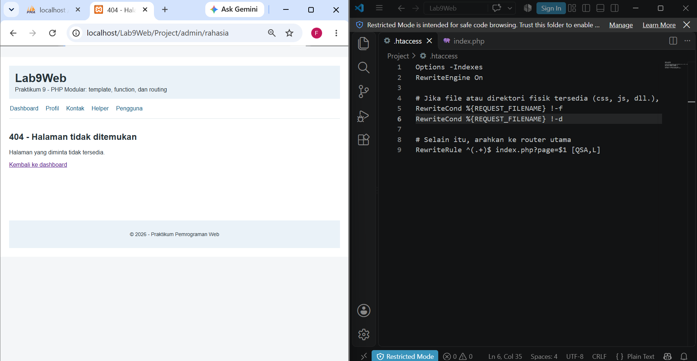

### 5.7 Integrasi dengan Aplikasi Database

Tahap selanjutnya adalah mengintegrasikan struktur PHP Modular dengan aplikasi database dari praktikum sebelumnya.

Project CRUD sebelumnya disalin ke project baru agar pengembangan modular tidak mengubah project asli. File koneksi database dipindahkan ke direktori config, template tampilan dipisahkan ke direktori views, function umum dipindahkan ke helpers, dan halaman CRUD dikelompokkan ke modules/user.

Koneksi database dikelola melalui file konfigurasi agar tidak dibuat berulang pada setiap halaman. File konfigurasi dimuat menggunakan `require_once` karena merupakan file wajib yang tidak boleh dimuat lebih dari satu kali.

Fitur CRUD yang diintegrasikan meliputi:

- Menampilkan data pengguna.
- Menambahkan data pengguna.
- Mengubah data pengguna.
- Menghapus data pengguna.

Seluruh halaman CRUD diakses melalui router dan menggunakan template tampilan yang sama.

**Screenshot Praktik 11 — Konfigurasi Database**

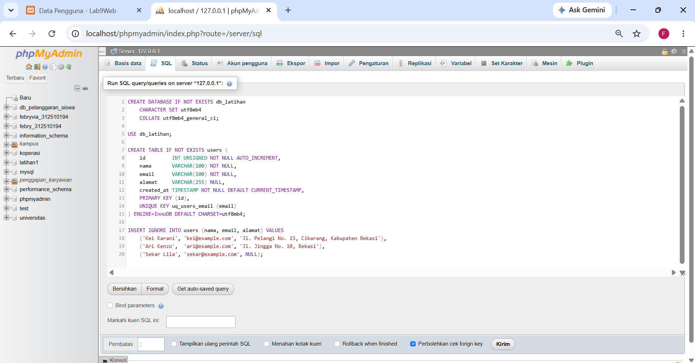


**Screenshot Praktik 12 — Data Pengguna**


**Screenshot Praktik 13 — Tambah Data Pengguna**


**Screenshot Praktik 14 — Edit Data Pengguna**


**Screenshot Praktik 15 — Hasil CRUD**


### 5.8 Latihan Terstruktur

Latihan terstruktur pada modul Praktikum 9 terdiri dari empat latihan.

#### Latihan 1 — Template Multi-Halaman

Membuat halaman Home, Profil, dan Kontak yang menggunakan header dan footer yang sama.

Penerapan template dilakukan dengan memisahkan tampilan bersama ke dalam file header dan footer, sedangkan konten setiap halaman ditempatkan pada file masing-masing.

Kriteria: tidak ada salinan kode header/footer pada file halaman, navigasi berfungsi, dan tampilan konsisten.

#### Latihan 2 — Library Function

Membuat helper function yang terdiri dari:

- `formatRupiah()`
- `hitungDiskon()`
- `validasiEmail()`
- `ringkasTeks()`

Function disimpan dalam file helpers/functions.php dan digunakan kembali pada halaman aplikasi.

Kriteria: setiap function memiliki tujuan jelas, parameter sesuai, dan nilai return digunakan dengan benar.

#### Latihan 3 — Router Aman

Mengembangkan router dengan daftar rute yang telah ditentukan, halaman 404, dan validasi rute.

Penggunaan whitelist dilakukan agar aplikasi hanya memuat halaman yang telah didaftarkan.

Kriteria: rute valid dapat diakses, rute tidak dikenal menghasilkan status 404, dan struktur kode mudah dibaca.

#### Latihan 4 — Refactoring CRUD

Mengintegrasikan aplikasi CRUD dari praktikum sebelumnya ke struktur PHP Modular. Seluruh halaman menggunakan template bersama, koneksi database dikelola melalui konfigurasi, dan navigasi halaman dilakukan melalui router.

Kriteria: operasi CRUD tetap berjalan, koneksi database hanya dikelola pada satu file konfigurasi, dan tautan antarhalaman menggunakan routing.

**Screenshot Praktik 16 — Hasil Latihan Terstruktur**

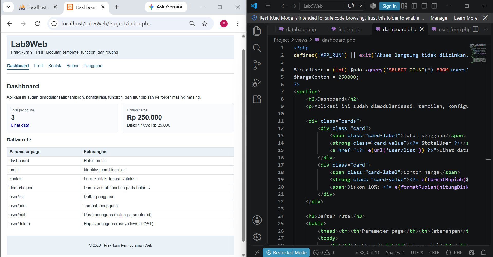

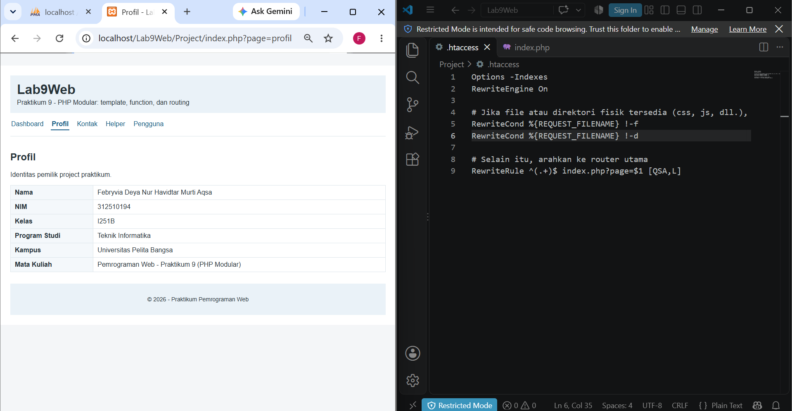

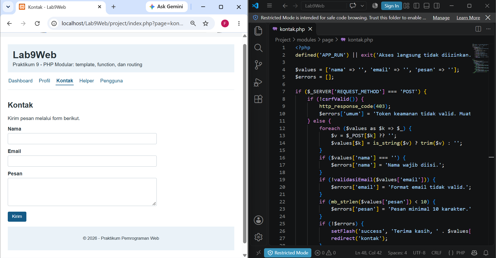


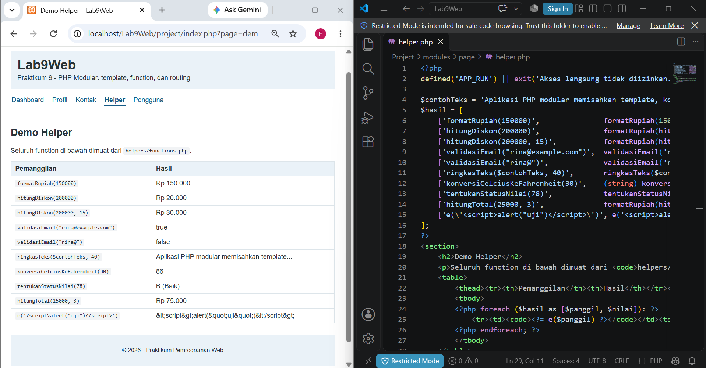


### 5.9 Tantangan Mandiri

Tantangan mandiri dilakukan untuk menambahkan beberapa fitur pada aplikasi modular.

#### 1. Active Navigation

Menu navigasi diberikan penanda aktif berdasarkan rute halaman yang sedang dibuka. Penanda tersebut membantu pengguna mengetahui halaman yang sedang diakses.

#### 2. Pesan Sukses dan Gagal

Helper pesan notifikasi digunakan untuk menampilkan informasi kepada pengguna setelah suatu proses dilakukan, seperti proses penambahan, perubahan, atau penghapusan data.

Pesan disimpan sementara menggunakan session dan ditampilkan pada halaman melalui template.

#### 3. Pembatasan Akses

Pembatasan akses diterapkan pada halaman pengelolaan pengguna. Pengguna yang belum login akan diarahkan ke halaman login ketika mencoba mengakses halaman CRUD.

#### 4. URL Rewrite

URL Rewrite diterapkan melalui file `.htaccess` agar alamat halaman lebih ringkas. Pengaturan dan pengujian dilakukan pada server Apache.

**Screenshot Praktik 17 — Active Navigation dan Notifikasi**


### 5.10 Tantangan Login dan Logout

Sebagai tambahan pada tantangan pembatasan akses, dibuat fitur login dan logout sederhana menggunakan session PHP.

Konfigurasi autentikasi disimpan pada `config/auth.php`. Function `isLoggedIn()` digunakan untuk memeriksa status login pengguna.

Pada halaman login dilakukan pemeriksaan username dan password. Password diperiksa menggunakan `password_verify()`, sedangkan session diperbarui menggunakan `session_regenerate_id(true)` setelah login berhasil.

Form login juga menggunakan token CSRF untuk membantu melindungi permintaan form.

Ketika pengguna berhasil login, aplikasi mengarahkan pengguna ke halaman Data Pengguna. Sementara itu, proses logout dilakukan melalui permintaan POST, mengosongkan session, dan mengarahkan pengguna kembali ke halaman login.

Fitur autentikasi yang dibuat meliputi:

- Form login.
- Validasi username dan password.
- Pemeriksaan password menggunakan `password_verify()`.
- Penggunaan session PHP.
- Pemeriksaan status login menggunakan `isLoggedIn()`.
- Proteksi halaman CRUD.
- Token CSRF pada form.
- Logout untuk mengakhiri session.

**Screenshot Praktik 18 — Halaman Login**


**Screenshot Praktik 19 — Login Berhasil**

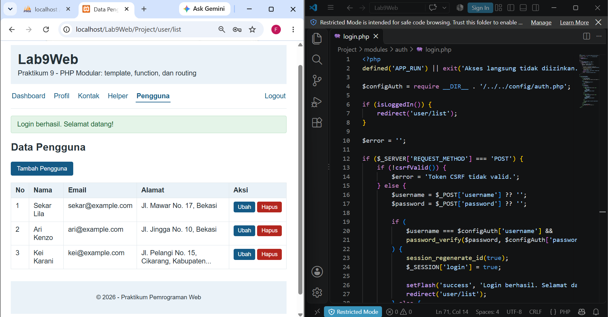

**Screenshot Praktik 20 — Logout**


## 6. Hasil Pengujian

Pengujian dilakukan untuk memastikan setiap fitur yang telah dikembangkan dapat berjalan sesuai fungsinya.

| No. | Fitur | Hasil |
|---|---|---|
| 1 | Template header dan footer | Berhasil digunakan pada halaman aplikasi |
| 2 | Navigasi | Berhasil berpindah halaman |
| 3 | Helper function | Berhasil digunakan pada aplikasi |
| 4 | Routing | Berhasil memuat halaman sesuai rute |
| 5 | Halaman 404 | Berhasil menangani rute yang tidak tersedia |
| 6 | URL Rewrite | Berhasil mengakses halaman melalui URL ringkas |
| 7 | Database | Berhasil terhubung dengan aplikasi |
| 8 | CRUD | Fitur tambah, tampil, edit, dan hapus data berjalan |
| 9 | Active Navigation | Menu aktif mengikuti halaman yang dibuka |
| 10 | Flash Message | Notifikasi dapat ditampilkan setelah proses |
| 11 | Login | Username dan password dapat diverifikasi |
| 12 | Logout | Session login dapat diakhiri |
| 13 | Proteksi halaman | Halaman CRUD dibatasi untuk pengguna yang belum login |

Pengujian rute pada halaman 404 mencakup parameter yang tidak terdaftar (`page=admin/rahasia`), parameter kosong (`page=`), parameter bertipe tidak sesuai (`page[]=x`), dan percobaan path traversal (`page=../config/database`). Seluruhnya menampilkan halaman 404.

## 7. Kendala dan Penyelesaian

Selama proses pengerjaan praktikum, terdapat beberapa kendala yang ditemui.

### 7.1 Penyesuaian Struktur File

Ketika file aplikasi dipisahkan ke dalam beberapa direktori, path pemanggilan file perlu disesuaikan agar setiap file dapat dimuat dengan benar.

Penyelesaian dilakukan dengan menggunakan `__DIR__` dalam pemanggilan file sehingga path mengacu pada lokasi file yang digunakan.

### 7.2 Routing dan URL

Pada saat menerapkan routing, setiap halaman perlu didaftarkan pada router agar dapat diakses melalui parameter page.

Penyelesaian dilakukan dengan menggunakan daftar rute yang telah ditentukan serta menyesuaikan tautan navigasi dengan helper URL.

### 7.3 URL Rewrite

Penggunaan URL Rewrite memerlukan pengaturan Apache dan file `.htaccess` yang sesuai.

Penyelesaian dilakukan dengan mengatur aturan rewrite dan menguji URL secara langsung melalui browser.

### 7.4 Penyesuaian Tampilan Login

Pada saat membuat halaman login, beberapa class HTML perlu disesuaikan dengan CSS yang digunakan pada project agar tampilan form lebih teratur dan konsisten dengan halaman lainnya.

### 7.5 Pengujian Login dan Logout

Pengujian dilakukan dengan memasukkan username dan password, memastikan pengguna dapat masuk ke halaman Data Pengguna, kemudian melakukan logout.

Selain itu, akses halaman CRUD diuji kembali setelah logout untuk memastikan halaman tersebut tidak dapat dibuka tanpa status login.

## 8. Jawaban Pertanyaan Pemahaman

**1. Jelaskan pengertian modularisasi program dan minimal tiga manfaatnya.**

Modularisasi adalah teknik membagi aplikasi menjadi bagian-bagian kecil berdasarkan fungsi atau tanggung jawabnya sehingga setiap bagian dapat digunakan kembali. Manfaatnya: (1) kode tidak ditulis berulang karena header, footer, koneksi, dan validasi dipakai bersama; (2) pemeliharaan lebih mudah karena perubahan cukup dilakukan pada modul terkait; (3) kode lebih mudah dipahami, diuji, dan ditelusuri; (4) pekerjaan tim dapat dibagi per modul sehingga mengurangi konflik pada file besar.

**2. Apa perbedaan `include` dan `require` ketika file yang dipanggil tidak ditemukan?**

`include` menghasilkan peringatan (warning) dan eksekusi program berlanjut, sedangkan `require` menghasilkan error fatal dan eksekusi dihentikan. Pada percobaan, baris setelah pemanggilan tetap tampil pada `include`, tetapi tidak tampil pada `require`.

**3. Mengapa `require_once` sesuai digunakan untuk memuat konfigurasi database?**

Konfigurasi database adalah file wajib; tanpanya aplikasi tidak dapat bekerja sehingga lebih tepat berhenti dengan error fatal (`require`). Akhiran `_once` memastikan file hanya dimuat satu kali sehingga koneksi tidak dibuat ganda dan tidak terjadi deklarasi ulang.

**4. Jelaskan perbedaan parameter, argumen, dan nilai return pada function.**

Parameter adalah variabel yang didefinisikan pada deklarasi function (misalnya `$panjang` dan `$lebar`). Argumen adalah nilai yang dikirim saat function dipanggil (misalnya 8 dan 5). Nilai return adalah nilai yang dikembalikan function kepada pemanggilnya melalui kata kunci `return` (misalnya 40) dan dapat disimpan atau dipakai dalam perhitungan lain.

**5. Mengapa header dan footer sebaiknya dipisahkan dari konten halaman?**

Header dan footer sama untuk semua halaman, sedangkan konten berbeda-beda. Dengan memisahkannya, bagian umum ditulis satu kali dan dipakai ulang, perubahan tampilan cukup dilakukan di satu file, dan setiap halaman hanya berisi konten khususnya.

**6. Apa fungsi `index.php` pada pola routing yang dipraktikkan?**

`index.php` adalah titik masuk tunggal sekaligus router. File ini membaca parameter `page`, memeriksanya terhadap daftar rute, memilih file konten yang sesuai (atau halaman 404), lalu memuat header, konten, dan footer secara berurutan.

**7. Mengapa router sebaiknya menggunakan whitelist rute?**

Whitelist hanya mengizinkan halaman yang memang didaftarkan aplikasi. Input pengguna tidak pernah menentukan file apa yang dijalankan, sehingga file lain di server tidak dapat dipanggil, dan rute yang tidak dikenal otomatis menghasilkan 404.

**8. Apa risiko jika input `page` langsung digabungkan menjadi path file yang di-require?**

Penyerang dapat memakai path traversal (misalnya `../config/database`) atau nama file lain untuk memuat dan menjalankan file yang tidak dimaksudkan, sehingga membuka kebocoran informasi atau eksekusi kode (local file inclusion).

**9. Apa fungsi aturan `RewriteCond` dan `RewriteRule` pada `.htaccess`?**

`RewriteCond` menetapkan syarat aturan berlaku; pada praktikum, syaratnya adalah permintaan bukan file (`!-f`) dan bukan direktori (`!-d`) yang ada secara fisik. `RewriteRule` melakukan penulisan ulang URL; semua permintaan yang memenuhi syarat diteruskan ke `index.php?page=<path>` sehingga URL tampil lebih ringkas.

**10. Sebutkan bagian aplikasi CRUD yang paling tepat dipindahkan ke config, views, helpers, dan modules.**

- **config:** koneksi database (`config/database.php`), serta akun login (`config/auth.php`).
- **views:** header, footer, dashboard, halaman 404, dan partial form pengguna.
- **helpers:** function umum seperti `e()`, `validasiEmail()`, `formatRupiah()`, `ringkasTeks()`, pesan flash, dan token CSRF.
- **modules:** halaman fitur CRUD pengguna (`list`, `add`, `edit`, `delete`), halaman umum (`profil`, `kontak`, `helper`), dan autentikasi (`login`, `logout`).

## 9. Kesimpulan

Praktikum PHP Modular memberikan pemahaman mengenai pengembangan aplikasi PHP dengan membagi program berdasarkan fungsi dan tanggung jawabnya.

Penerapan template, helper function, konfigurasi database, dan routing membuat struktur aplikasi lebih terorganisasi. Integrasi CRUD menunjukkan bahwa aplikasi dari praktikum sebelumnya dapat dikembangkan tanpa harus menuliskan ulang seluruh kode dalam satu file.

Selain itu, penerapan URL Rewrite, active navigation, flash message, serta login dan logout menambah fungsi aplikasi dan memberikan pemahaman mengenai pengelolaan halaman, navigasi, dan pembatasan akses.

Dengan menyelesaikan praktikum ini, aplikasi PHP yang dikembangkan menjadi lebih terstruktur, mudah dipahami, dan lebih mudah dikembangkan kembali.

## 10. Dokumentasi

Dokumentasi project berupa screenshot proses pengerjaan dan hasil pengujian disimpan pada direktori `screenshots/`.

Screenshot digunakan sebagai bukti pelaksanaan praktikum mulai dari pemanggilan file PHP, pembuatan template, function, struktur direktori, routing, URL Rewrite, integrasi CRUD, hingga fitur autentikasi.

## 11. Repository

Project ini dibuat untuk memenuhi kegiatan Praktikum 9 Pemrograman Web dengan topik PHP Modular.

Repository GitHub:

https://github.com/febryviadeyanur-cmd/Lab9Web